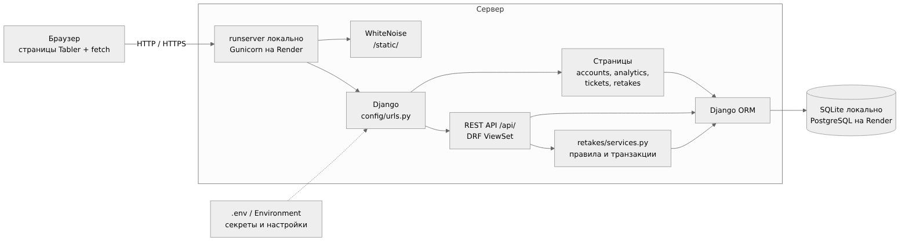
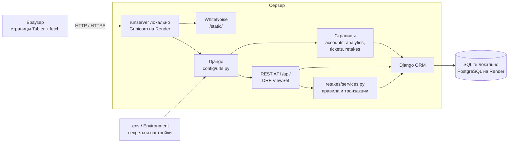

# Архитектура проекта

## Структура каталогов

```
django_auth/
├── config/              настройки проекта: settings.py, корневые urls.py, wsgi.py
├── accounts/            факультеты, группы, курсы, профили студентов, оценки; страницы справочников
│   ├── fixtures/demo_data.json      учебные данные
│   └── management/commands/         init_demo, seed_analytics
├── analytics/           дашборды успеваемости и JSON для графиков (services.py)
├── manager/             REST API факультетов и курсов, страница «Менеджер данных»
├── tickets/             модели и REST API обращений, страница «Мои обращения»
├── retakes/             бизнес-процесс «Запись на пересдачу»
│   ├── services.py                  таблица переходов, правила, транзакция perform()
│   └── management/commands/         seed_retakes
├── templates/           base.html (каркас Tabler) и шаблоны страниц по разделам
├── static/              css/, js/ (скрипты страниц), vendor/ (Tabler, ApexCharts)
├── docs/                документация
├── manage.py
├── requirements.txt     зависимости с точными версиями
├── .env.example         образец переменных окружения без секретов
├── build.sh             сборка на сервере: зависимости, collectstatic, migrate, init_demo
├── render.yaml          описание базы и веб-сервиса для Render (Blueprint)
├── .python-version      версия Python для Render
└── run_windows.bat      локальный запуск одной командой
```

Не входят в репозиторий (`.gitignore`): `.env`, `db.sqlite3`, `venv/`, `staticfiles/`, `__pycache__/`.

## Схема архитектуры



Исходный текст схемы (Mermaid, отображается на GitHub):



## Как проходит запрос

1. Браузер открывает страницу, например `/retakes/`. Django проверяет вход и отдаёт HTML-шаблон
   с каркасом `base.html`; CSS и JS отдаёт WhiteNoise (при `DEBUG=True` — сам Django).
2. Скрипт страницы (`static/js/retakes.js`) запрашивает данные через `fetch('/api/retakes/')`.
   Cookie сессии передаётся автоматически, для POST, PUT, PATCH и DELETE добавляется заголовок
   `X-CSRFToken`.
3. ViewSet проверяет права (SessionAuthentication + IsAuthenticated, роли), сериализатор проверяет
   данные, бизнес-операции выполняются в `services.perform()` внутри транзакции.
4. Ответ JSON возвращается в браузер, скрипт перерисовывает список без перезагрузки страницы.

## Роли

| Роль | Пользователь | Возможности |
|------|--------------|-------------|
| Студент | student1 | просмотр справочников, свои обращения и заявки на пересдачу |
| Методист | methodist (группа «Методист») | изменение справочников и курсов, одобрение и отклонение заявок |
| Администратор | admin | всё, включая `/admin/` |
