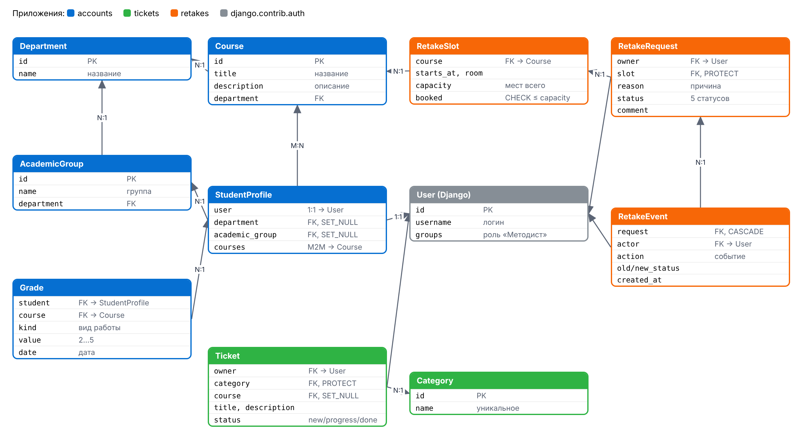
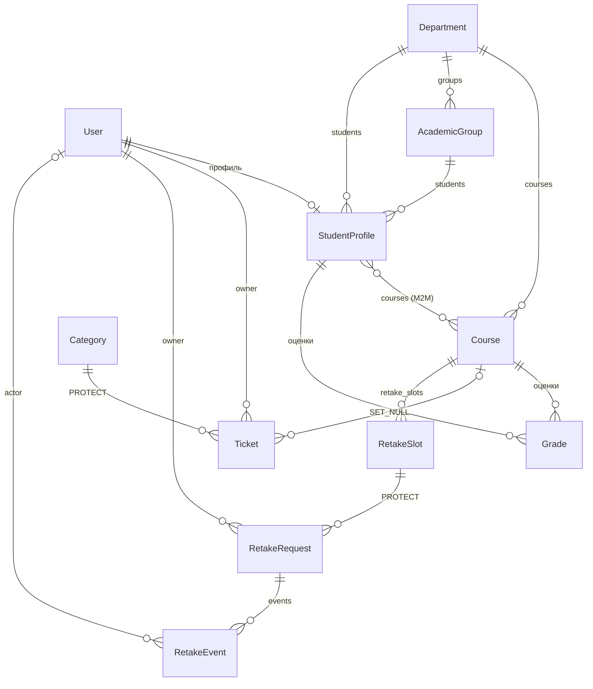

# База данных

Локально используется SQLite (`db.sqlite3` создаётся командой `migrate`), на Render — PostgreSQL.
Схема одна и та же: таблицы создаются миграциями Django из моделей. Это **разные базы**: записи,
созданные на своём компьютере, не появляются на Render, и наоборот. Учебные данные в каждую новую
базу загружает команда `python manage.py init_demo`.

## Схема моделей



Та же схема в Mermaid:



## Модели

### accounts

| Модель | Поля | Связи |
|--------|------|-------|
| Department — факультет | name | — |
| Course — курс | title, description | department → Department (CASCADE) |
| AcademicGroup — учебная группа | name | department → Department (CASCADE) |
| StudentProfile — профиль студента | — | user → User (1:1), department, academic_group (SET_NULL), courses (M2M) |
| Grade — оценка | kind (ПЗ, СРС, ЛР, контрольная), value 2–5, date | student → StudentProfile, course → Course |

### tickets

| Модель | Поля | Связи |
|--------|------|-------|
| Category — категория обращения | name (уникальное) | — |
| Ticket — обращение | title, description, status (new, progress, done), created_at, updated_at | category (PROTECT), course (SET_NULL), owner → User |

### retakes

| Модель | Поля | Связи и ограничения |
|--------|------|---------------------|
| RetakeSlot — время пересдачи | starts_at, room, capacity, booked | course → Course; CheckConstraint `booked <= capacity` |
| RetakeRequest — заявка | reason, status (draft, submitted, approved, rejected, cancelled), comment | owner → User, slot → RetakeSlot (PROTECT) |
| RetakeEvent — история | action, old_status, new_status, details, created_at | request → RetakeRequest (CASCADE), actor → User (SET_NULL) |

## Правила целостности

- `PROTECT` не даёт удалить категорию, по которой есть обращения, и время пересдачи с заявками.
- Удаление факультета с курсами API запрещает ответом 409 (иначе каскадно удалились бы курсы и оценки).
- Ограничение `slot_booked_lte_capacity` проверяется самой базой: занятых мест не может быть больше,
  чем всего.
- Подача, одобрение, отклонение и отмена заявки выполняются в одной транзакции
  (`transaction.atomic` + `select_for_update`): статус заявки, число занятых мест и событие истории
  сохраняются вместе или не сохраняются вовсе.

## Миграции и данные

```bash
python manage.py showmigrations   # какие миграции применены
python manage.py migrate          # применить
python manage.py init_demo        # учебные данные (только в пустую базу)
python manage.py seed_analytics   # пересоздать студентов и оценки для дашбордов
python manage.py seed_retakes     # пересоздать время пересдач и заявки
```
